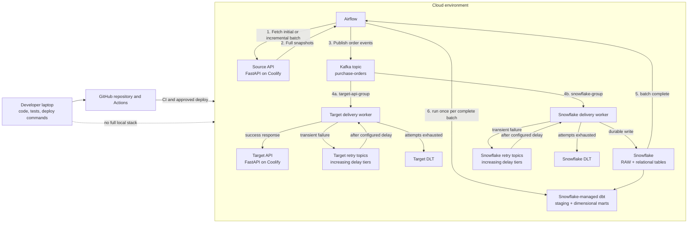
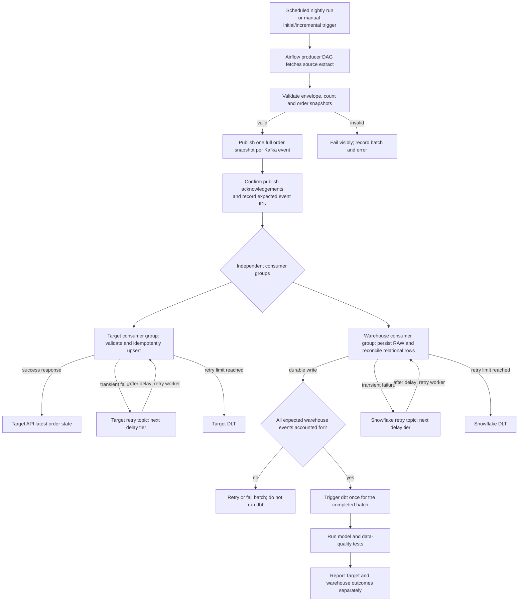

# Purchase Order Integration and Analytics Pipeline

A cloud-hosted, scheduled pipeline for moving purchase-order snapshots from a FastAPI source through Kafka to two independent destinations: a FastAPI target system and Snowflake. Airflow orchestrates each finite batch, and dbt builds reporting models over the required relational tables.

> **Project status:** The Source and Target APIs, Kafka tools, and four Astro DAGs are implemented. The analytics DAG expects an existing Snowflake-managed dbt project. See [Astro setup and recovery](airflow/README.md) for runtime configuration.

## Run the Source API

Set `SOURCE_API_USERNAME` and `SOURCE_API_PASSWORD` in your local `.env`. Use ASCII credentials and a username without a colon. From the repository root, build and start the service.

```bash
docker compose up --build -d
curl http://127.0.0.1:8000/health
curl --user 'your-source-username' 'http://127.0.0.1:8000/purchase-orders?load_type=initial'
curl --user 'your-source-username' 'http://127.0.0.1:8000/purchase-orders?load_type=incremental'
```

The API returns the full JSON envelopes bundled in `api/source/sample_data/`, with 100 initial records and 20 incremental records. The `load_type` parameter is required and accepts `initial` or `incremental`. Use `docker compose down` to stop the service.

To run with Python 3.12 from the repository root:

```bash
python3 -m venv .venv
source .venv/bin/activate
python -m pip install -r api/source/requirements.txt
set -a
source ./.env
set +a
python -m uvicorn api.source.main:app
```

## Run the Target API

Set `TARGET_API_USERNAME`, `TARGET_API_PASSWORD`, `MYSQL_PASSWORD` and `MYSQL_ROOT_PASSWORD` in your local `.env` using the names in `.env.example`. Use ASCII for the Basic Auth credentials and separate passwords for the API, MySQL application user and MySQL root. Use HTTPS for Basic Auth outside local development. The Compose target profile starts the API and an internal MySQL server with a persistent named volume. MySQL initializes the database and table on first startup.

```bash
docker compose --profile target up --build -d target-api
curl http://127.0.0.1:8001/health
```

`POST /purchase-orders` accepts one JSON order and uses its `OrderNumber` as the lookup key. Pass the Basic Auth username to curl and enter the password when prompted.

```bash
curl -i --user 'your-target-username' \
  -X POST http://127.0.0.1:8001/purchase-orders \
  -H 'Content-Type: application/json' \
  -d '{"OrderNumber":"PO1040078","OrderStatus":"Open","OrderLines":[]}'
```

| HTTP status | Result |
|---|---|
| `200 OK` | `inserted` for a new order, `updated` for a changed snapshot, or `duplicate` for an identical snapshot |
| `401 Unauthorized` | Missing or invalid Basic Auth credentials |
| `422 Unprocessable Content` | Invalid order or missing or invalid `OrderNumber` |
| `500 Internal Server Error` / `503 Service Unavailable` | Database operation failed or the database is unavailable |

MySQL stores one complete snapshot per order number, including all nested rows. Duplicate detection compares the whole current JSON document. Object field order is ignored, and arrays are compared in order. Airflow sends an `Idempotency-Key` with each event and a timezone-aware `LastUpdated` in the order. The API records the event ID with the write and returns `stale` when a newer snapshot is already stored. Reusing the key with a different payload returns HTTP 409.

### Initialize an external MySQL database

Create the database before starting the Target API. At startup, the API checks `purchase_orders` and `purchase_order_events`. The runtime account needs `SELECT`, `INSERT`, and `UPDATE` on both tables, plus `CREATE` to initialize either table automatically.

If the runtime account lacks `CREATE`, run the following once from a machine that can reach MySQL. Use a setup account with `CREATE` permission on the database.

```bash
source .venv/bin/activate
python -m pip install -r api/target/requirements.txt
(
  export MYSQL_HOST='your-mysql-host' MYSQL_PORT=3306
  export MYSQL_DATABASE='your-database' MYSQL_USER='your-setup-user'
  printf 'MySQL setup password: '
  read -rs MYSQL_PASSWORD
  printf '\n'
  export MYSQL_PASSWORD
  python -m api.target.init_db
)
```

Both startup and the initializer preserve existing rows. The local MySQL Compose service also applies both schema files when it first initializes its volume. If the schema evolves, run versioned migrations before deployment from an environment with database access.

## API authentication and Swagger

Both APIs use Basic Auth for purchase-order requests and Swagger UI. Open [Source Swagger](http://127.0.0.1:8000/docs) or [Target Swagger](http://127.0.0.1:8001/docs) and sign in with that API's credentials. Swagger's **Authorize** control is available for making requests from the UI. The OpenAPI JSON that Swagger loads is also protected.

`GET /health` is public on both services so container and deployment probes can check readiness without credentials. Use HTTPS when sending Basic Auth credentials outside local development.

## Prepare Aiven Kafka

Use the [initialization workflow](#initialize-an-environment-with-github-actions) to set up MySQL and Kafka, or configure Kafka manually with the steps below.

1. **Create the topic.** Open your Kafka service and select **Topics → Create topic**. Use the `kafka.topic` name in [application.properties](integration/po_pipeline/application.properties), or set `KAFKA_TOPIC` to override it for a client. Use one partition for the demo and a replication factor supported by your service plan. Create `purchaseorders-test` as well if you want a dedicated topic for the single-message test below. [Aiven topic setup](https://aiven.io/docs/products/kafka/howto/create-topic)
2. **Create a service user.** Open **Access & Control → Users** and create a dedicated Kafka user such as `purchaseorders-demo`. Use its generated password and save it in your local `.env` or runtime secret store. When deploying independent workers, give the producer and each consumer their own service user so their permissions can be managed independently. [Aiven service users](https://aiven.io/docs/products/kafka/howto/add-manage-service-users)
3. **Choose consumer group IDs.** Use `purchaseorders-consumer` for the inspection CLI and `purchase-orders-backend` and `purchase-orders-analytics` for the delivery DAGs. Kafka manages group state when consumers connect and commit offsets. You can grant access to the ID before starting the consumer. Set `KAFKA_CONSUMER_GROUP_ID` to the group you granted for the CLI. [Apache Kafka consumer groups](https://kafka.apache.org/41/javadoc/org/apache/kafka/clients/consumer/KafkaConsumer.html)
4. **Grant access.** In **Access & Control → ACL → Kafka-native ACLs**, add the applicable rules below. Set permission type to `ALLOW`, principal to `User:<service-username>`, pattern type to `LITERAL`, and host to `*` if access should work from any client IP. Use the exact topic and group names. For `GroupAuthorizationFailedError`, check the saved group rule and any matching `DENY` entries. [Aiven ACL setup](https://aiven.io/docs/products/kafka/howto/manage-acls#add-a-kafka-native-acl-entry)

   | Client | Operation | Resource type | Resource |
   |---|---|---|---|
   | Producer | Write | Topic | `purchase-orders` |
   | Consumer | Read | Topic | `purchase-orders` |
   | Consumer | Read | Group | Its exact group ID, such as `purchaseorders-consumer` |

   If you use one service user for the demo, apply all three rules to that user. If you create the optional test topic, grant the producer `Write` and the inspection consumer `Read` on `purchaseorders-test` too.

5. **Get the connection settings and CA certificate.** In the Kafka service, open **Overview → Quick connect → Python**. Select your topic, **SASL**, and your service user. Under **Downloads**, save the CA certificate as `integration/aiven_ca.pem`. Copy the SASL host and port into `KAFKA_BOOTSTRAP_SERVERS` and the password into `KAFKA_PRODUCER_SASL_PASSWORD` or `KAFKA_INSPECTION_SASL_PASSWORD` for the matching user in `application.properties`. The properties file supplies the SASL defaults, and `.env.example` supplies the CA file path. [Aiven Python connection guide](https://aiven.io/docs/products/kafka/howto/connect-with-python)

Use these commands from the repository root to set up the virtual environment and install the Kafka client.

```bash
test -d .venv || python3 -m venv .venv
source .venv/bin/activate
python -m pip install -r integration/requirements.txt
test -f .env || (umask 077 && cp .env.example .env)
```

Fill in `.env` with the settings above. Quote values containing shell special characters. Git ignores `.env` and `integration/aiven_ca.pem`.

[application.properties](integration/po_pipeline/application.properties) defines the provisioning settings and defaults for the Kafka command-line tools. A value written as `${ENV_VAR}` is resolved from the process environment when the command uses that setting. Export your local `.env` before running commands. GitHub Actions supplies provisioning and verification settings. Configure the DAG runtime separately in [Astro](airflow/README.md#set-up-the-deployment).

```bash
set -a
source ./.env
set +a
```

### Initialize an environment with GitHub Actions

Set the Kafka names and topic creation settings in [application.properties](integration/po_pipeline/application.properties). Use the exact name of your existing topic if you want to keep using it. In **GitHub → Settings → Environments**, configure the same setting names for each environment you use, such as `test` and `prod`. Set the values to point to that environment's MySQL database and Aiven service.

| Kind | Name | Value |
|---|---|---|
| Variables | `MYSQL_HOST`, `MYSQL_DATABASE` | Address reachable from the workflow runner and name of the existing database |
| Optional variable | `MYSQL_PORT` | Defaults to `3306` |
| Variable | `MYSQL_INIT_USER` | Setup account with `CREATE` permission in that database |
| Secret | `MYSQL_INIT_PASSWORD` | Password for the MySQL setup account |
| Variables | `AIVEN_PROJECT`, `AIVEN_SERVICE_NAME` | Aiven project and Kafka service names |
| Secret | `AIVEN_API_TOKEN` | Token authorized to create topics and users and manage Kafka-native ACLs |

Run **Actions → Initialize environment → Run workflow** and choose the GitHub environment. Select `mysql-and-kafka` to initialize MySQL and provision Aiven. The default `all` also initializes Snowflake when the environment is `test`. If MySQL is private, the runner needs a network route to it. [Manual workflow runs](https://docs.github.com/en/actions/how-tos/manage-workflow-runs/manually-run-a-workflow)

Use `snowflake` in [Initialize environment](.github/workflows/initialize-environment.yml) to create the RAW table, four CLEAN tables, and BIZ tables and views in `test` independently. Then publish the dbt project using the `dbt` option in [Deploy APIs, DAGs, and dbt](.github/workflows/deploy-apis-dags-dbt.yml). See [Snowflake and dbt ownership](airflow/README.md#snowflake-and-dbt-ownership) for prerequisites and Power BI access.

Retrieve the Kafka users' generated passwords from Aiven and configure them in [Astro](airflow/README.md#set-up-the-deployment). The workflow keeps passwords out of GitHub logs and artifacts. The Astro deployment and Snowflake schemas and managed dbt project are configured separately. [Aiven service users](https://aiven.io/docs/products/kafka/howto/add-manage-service-users)

| Provisioned user | Topic access | Consumer group access |
|---|---|---|
| `airflow-producer` | Write `purchase-orders` | |
| `airflow-consumer` | Read `purchase-orders`, write `purchase-orders.backend.dlt` and `purchase-orders.analytics.dlt` | Read `purchase-orders-backend` and `purchase-orders-analytics` |

The workflow skips existing topics, users, and exact grants. Existing ACLs stay in place, including any `DENY` rules that take precedence. The group ACLs are created ahead of consumption. See [delivery and recovery](airflow/README.md#delivery-and-recovery) for Kafka offset handling and dead-letter topics. [Aiven Kafka-native ACLs](https://aiven.io/docs/products/kafka/howto/manage-acls)

You can also run `python -m integration.provision_kafka` from the repository root with the same three Aiven settings supplied as environment variables.

## Publish an extract to Kafka

Start the Source API and load the Kafka environment above before running the producer. Set `SOURCE_API_URL` to the API base URL and supply its `SOURCE_API_USERNAME` and `SOURCE_API_PASSWORD` to the producer.

```bash
python -m integration.kafka_producer initial
python -m integration.kafka_producer incremental
```

Each command fetches one extract and publishes one message per record, with `OrderNumber` as its key and the full order JSON as its value. Kafka headers carry `batch_id`, `event_id`, `load_type` and `extracted_at`. The command prints the count after Kafka acknowledges every record. A failed run may have published part of the batch. Rerunning the same extract produces the same event IDs so consumers can deduplicate.

### Publish one JSON message

With the Kafka connection variables exported, run this from the repository root:

```bash
python -m integration.k_producer purchaseorders-test '{"message":"Hello Kafka"}'
```

Use an existing topic you can write to. Keep the JSON inside single quotes so the shell passes it as one argument. The CLI takes the topic from the command line and the broker address and port, TLS settings, and SASL credentials from the same environment variables as the batch producer. It prints the partition and offset after Kafka acknowledges the message.

## Inspect Kafka messages

With the same Kafka environment variables loaded, run the inspection consumer:

```bash
python -m integration.kafka_consumer --max-messages 20 --idle-timeout 10
```

To inspect the optional smoke-test topic, prefix the command with `KAFKA_TOPIC=purchaseorders-test`.

It prints each message's UTF-8 key and value with its partition and offset, then commits the offset for the inspection group. Omit both flags to keep listening until Ctrl+C.

The default inspection group is `purchaseorders-consumer`. It resumes at its committed offsets on restart. Set `KAFKA_CONSUMER_GROUP_ID` to a fresh group to read retained messages from the beginning with the default `KAFKA_AUTO_OFFSET_RESET=earliest`. Use a dedicated inspection group to keep delivery workers' offsets independent. Set `KAFKA_CONSUMER_CLIENT_ID` to override the default client ID.

## Problem

The exercise is to build a reproducible integration pipeline for nested purchase-order JSON. It must deliver orders to both an operational target API and an analytics warehouse, preserve updates from an initial and an incremental extract, and provide a dimensional model for reporting. Kafka and Airflow are required parts of the design. The work should be demonstrable from a personal GitHub repository, with documented decisions and visible CI runs.

The brief and ER diagram are in [`requirements_docs/`](requirements_docs/). The fictional source fixtures are bundled in [`api/source/sample_data/`](api/source/sample_data/).

### Requirements

| ID | Requirement |
|---|---|
| R-01 | Implement a FastAPI source API that serves the supplied purchase orders. |
| R-02 | Implement a FastAPI target API that receives purchase orders. |
| R-03 | Deliver data to both the target API and Snowflake. |
| R-04 | Use Kafka publish/subscribe and Airflow orchestration, and explain their roles. |
| R-05 | Store the four relational purchase-order tables represented in the ER diagram in Snowflake. |
| R-06 | Use dbt to build a dimensional model on top of those four tables. |
| R-07 | Handle both extracts correctly; incremental records represent complete current snapshots of changed orders. |
| R-08 | Preserve parent order/line keys when flattening nested lines, coding rows and goods receipts. |
| R-09 | Use a personal GitHub repository and provide a visible GitHub Actions run. |
| R-10 | Document design decisions, including context, options, rationale and trade-offs. |
| R-11 | Use personal/local/free-tier or trial resources, and do not commit secrets. |
| R-12 | Be ready to walk through the solution in a 45–60-minute review. |

**Optional bonus items:** local Kubernetes deployment with Helm or Kustomize, and end-to-end OpenTelemetry tracing. These are deferred until the required path works.

### Required Snowflake tables

| Table | Key | Grain |
|---|---|---|
| `PURCHASE_ORDER` | `OrderNumber` | One row per order snapshot/current order. |
| `PURCHASE_ORDER_LINE` | `OrderNumber`, `LineNumber` | One row per order line. |
| `PURCHASE_ORDER_LINE_CODING_ROW` | `OrderNumber`, `LineNumber`, `RowIndex` | One row per coding/allocation row. |
| `PURCHASE_ORDER_LINE_GOODS_RECEIPT` | `GoodsReceiptNumber` | One row per goods receipt, linked to its parent order and line. |

The sample data has 100 initial order records and 20 incremental records. The incremental file contains 19 distinct order numbers, including two versions of `PO1040078`; it introduces four new orders. After selecting the newest version per order, the expected current header count is 104. Child-row counts must be calculated from the selected latest snapshots, not by adding rows from both files.

## Assumptions

The brief does not specify production traffic, an update frequency, a latency SLA, retention, or an API error contract. These are provisional assumptions for a small candidate exercise and must be revisited if requirements change.

| ID | Working assumption | Consequence |
|---|---|---|
| A-01 | Order volume is low and new data arrives infrequently; a daily overnight batch is sufficient. | Use a scheduled Airflow micro-batch, not synchronous/inline order processing or always-on consumers. Confirm the timezone and run time before scheduling. |
| A-02 | The supplied initial and incremental files are deterministic demo extracts. | Support explicit `initial` and `incremental` modes for repeatable tests; do not pretend repeated fixture requests are new daily data. |
| A-03 | Each incremental record is a full snapshot of a changed order, not a patch. | Select the latest timezone-aware `LastUpdated` version and replace that order's child rows as a complete set. |
| A-04 | Target and Snowflake delivery are independent. | Use separate Kafka consumer groups and report their batch outcomes separately; one destination can succeed while the other retries or fails. |
| A-05 | The developer laptop has limited CPU, memory and disk. | Run APIs, Kafka and Airflow in cloud environments. Use the laptop for editing, unit tests and deployment operations; avoid running the full stack locally. |
| A-06 | Source and target APIs will be deployed to the user's cloud server through Coolify. | Airflow must be able to reach their deployed HTTPS endpoints; do not configure cloud tasks to call laptop `localhost`. |
| A-07 | Snowflake is the warehouse and dbt runs in the Snowflake-managed environment. | Keep credentials in cloud secret stores/connections, not in source control. |
| A-08 | The exercise dataset is fictional and small, but correctness still matters. | Preserve financial values, cancelled statuses and negative reversing receipts; do not silently adjust business data. |

## Proposed solution

Airflow runs finite batch jobs in the cloud. The producer fetches one extract from the Source API, validates its envelope, creates stable event metadata, and publishes one full order snapshot per Kafka message. Two independent consumer flows deliver those events: one upserts the Target API, while the other writes raw events and reconciles the four relational tables in Snowflake. Once the warehouse batch is complete, Airflow invokes dbt to create tested staging and dimensional models.

### Architecture and planned retry topics

The flow diagrams show the proposed retry-topic design. The current DAGs use bounded Airflow retries and publish invalid records to the provisioned dead-letter topics. See [the current failure policy](airflow/README.md#delivery-and-recovery).



Development uses Aiven for Kafka and Astro for hosted Airflow. Astro tasks need secure connectivity to Kafka, Snowflake and the Coolify-hosted APIs. Keep services private where possible. For public endpoints, use HTTPS, authentication, TLS for Kafka, restricted network rules and scoped credentials.

### Batch and retry flow



### Event and update handling

- The Astro provisioning workflow defaults to `purchase-orders`. The message key is `OrderNumber`, and the Airflow event envelope contains the complete nested order snapshot.
- Event metadata: stable `event_id`, `batch_id`, `load_type`, extraction time, order number and optional Airflow run/trace identifiers.
- `event_id` must be stable on retry but distinguish separate versions of the same order. A deterministic identity can include extract identity, record position and a canonical payload hash.
- Normalize `LastUpdated` to a timezone-aware instant before comparing versions. A stale event must not overwrite a newer order. Define a deterministic tie-break for equal timestamps.
- Child rows are replaced/reconciled from the selected full snapshot. This removes children that disappeared from a later snapshot; a plain upsert alone is not sufficient.
- Keep one canonical `purchase-orders` topic and use the existing independent consumer groups for destination isolation. Add separate retry topics and DLTs for each destination: for example, `purchase-orders.target.retry.1m`, `purchase-orders.target.retry.5m`, `purchase-orders.target.retry.30m`, `purchase-orders.target.dlt`, and corresponding `purchase-orders.snowflake.retry.1m`, `purchase-orders.snowflake.retry.5m`, `purchase-orders.snowflake.retry.30m`, `purchase-orders.snowflake.dlt`. Separate primary topics are not required for this design; add them only if destinations need different access controls, retention, throughput or independent producer policies.
- Retry only transient failures, with a bounded number of attempts and increasing delay tiers. Route validation/permanent failures directly to the appropriate DLT with failure reason, attempt count and original event metadata. A DLT is an operational exception queue, not successful delivery; alert and document how to inspect and replay its records.
- Kafka does not natively wait for a per-message delay. A retry worker or scheduled Airflow task must enforce the delay tiers and publish to the next retry tier (or back to the destination worker). Do not sleep while holding a consumer partition if that would block other orders. Version-aware upserts are still needed because retries can cause later order versions to arrive first.
- Commit the source-topic offset only after the destination write is durable, or after publishing the failed event to its retry/DLT topic has itself been acknowledged. If the retry/DLT publish fails, do not commit the source offset. This is an at-least-once design: duplicate delivery is possible, so event processing must be idempotent.
- A Kafka acknowledgement does not delete a record. Committing an offset tells that consumer group it may move forward; Kafka retains the record until its retention policy expires. Target and Snowflake groups commit independently, and replay remains possible within retention.
- Track expected distinct event IDs per batch. A short/empty Kafka poll is not proof that the batch is complete.

For Target, treat a successful HTTP response as an acknowledgement only after the API has durably saved the snapshot and event identity. For Snowflake, acknowledge only after the event/audit write is committed. A DLT-published event remains unresolved for business completeness reporting until it is successfully replayed or explicitly dispositioned; do not silently count it as a successful target or warehouse write.

### Snowflake and dbt ownership

The analytics DAG merges full order snapshots into RAW by event ID, verifies each chunk, and runs the managed [dbt project](snowflake/dbt/) after a successful ingestion run. dbt refreshes the initialized CLEAN and BIZ tables in place. Managers and Power BI query the secure views in BIZ. See [Snowflake and dbt ownership](airflow/README.md#snowflake-and-dbt-ownership).

Suggested layers:

| Layer | Contents |
|---|---|
| `RAW` | Append-only full event payloads plus event/batch ingestion status. |
| Relational source tables | The four required tables above, maintained to current state from complete snapshots. |
| dbt staging | Typed, normalized order, line, coding and receipt models. |
| dbt marts | Dimensions such as supplier, cost centre and category; facts at line, allocation and receipt grain. |

Keep measures at their natural grain. Joining coding rows and receipts directly to order lines can multiply values. Negative receipt rows are reversals and must remain visible; order value is not the same as paid or invoiced expenditure.

## Design decisions

| Decision | Choice | Why | Trade-off / revisit when |
|---|---|---|---|
| Processing style | Manually triggered, finite Airflow batches. | The initial and incremental fixtures can be replayed independently. | Add a schedule when the real source frequency is known. |
| API placement | Source and target FastAPI services deployed on the user's Coolify cloud instance. | Cloud Airflow cannot reliably reach a laptop-local service; the laptop is resource-constrained. | Revisit if networking, availability or isolation requirements outgrow this host. |
| Kafka and Airflow | Aiven for development Kafka and Astro for hosted Airflow. | Keeps the laptop free of the heavyweight runtime and enables cloud-to-cloud connectivity. | Confirm Astro tasks can reach Kafka, Snowflake and the Coolify APIs. |
| Fan-out and recovery | One canonical topic, independent destination consumer groups, bounded Airflow retries, and dead-letter topics. | Each destination can resume from its own committed Kafka offsets. | Operators inspect and replay quarantined records from the relevant dead-letter topic. |
| Kafka payload | One complete order per event, keyed by order number. | Preserves order boundaries and supports partition affinity and replay. | Batch-level metadata must be tracked separately. |
| Batch orchestration | Three logical Airflow DAGs: extract/publish, Target delivery, warehouse ingestion/dbt. | Keeps source and destination responsibilities distinct. | Requires explicit cross-DAG batch completion and prevents unsafe overlapping runs. |
| Incremental semantics | Latest complete snapshot replaces current header and child state. | Matches the stated meaning of incremental records and handles child removals. | Requires timestamp normalization, deterministic ties and atomic reconciliation. |
| Target API | Basic Auth and MySQL-backed `POST /purchase-orders`. Keyed requests record the event ID and compare `LastUpdated` and a snapshot hash. | Replays and stale events leave a newer order intact. | Unkeyed clients use the original snapshot-upsert contract. |
| Warehouse model | Snowflake initialization defines the four relational tables and the BI objects. dbt populates the relational tables from RAW and builds analytics on top. | Keeps DDL and access grants stable when transformation code changes. | Each table refresh is atomic. A build can expose different refresh times across tables. |
| Optional work | Kubernetes and OpenTelemetry after required acceptance tests pass. | Protects the timebox and cloud budget. | Bonus work may be omitted if it puts correctness or delivery at risk. |

## Implementation checklist

Check items as they are completed. The checklist is a plan; unchecked items are not implemented yet.

### 1. Provision cloud services

- [ ] Create a personal Snowflake account/database, warehouse, schemas and least-privilege role.
- [ ] Create a cloud Kafka cluster and `purchase-orders` topic; configure TLS, credentials, partitions, retention and consumer access.
- [ ] Create destination-specific retry topics with increasing delay tiers and separate Target/Snowflake DLTs; set retention and access policies.
- [ ] Create a cloud Airflow environment and securely configure connections to Kafka, Snowflake and the Coolify API endpoints.
- [ ] Confirm cloud egress, DNS, firewall rules, HTTPS certificates, provider limits and expected charges.
- [ ] Decide how credentials will be stored and rotated; keep them out of Git and logs.

### 2. Build and deploy the APIs

- [x] Serve the fictional fixtures bundled in `api/source/sample_data/`.
- [x] Implement the deterministic Source API with explicit `initial` and `incremental` modes and response-count validation.
- [x] Implement the Target API with persistent state, Basic Auth and full-snapshot duplicate detection.
- [ ] Add processed-event idempotency and stale-version protection for Kafka delivery.
- [ ] Add API health checks, input validation, authentication and useful structured logs.
- [ ] Build and deploy both APIs to the Coolify instance; confirm Airflow can reach their HTTPS endpoints.

### 3. Implement Airflow and Kafka processing

- [ ] Define and test the event envelope, stable event identity and serialization contract.
- [ ] Implement the producer DAG: fetch, validate, assign batch/event metadata, publish and verify acknowledgements.
- [ ] Implement the Target consumer with bounded polling, transient-error classification, retry tiers, DLT handling, idempotent upsert and safe offset commits.
- [ ] Implement the Snowflake consumer with bounded polling, transient-error classification, retry tiers, DLT handling, durable raw ingestion, event audit and safe offset commits.
- [ ] Implement or schedule retry workers that enforce delay tiers without blocking unrelated partition work; document DLT inspection and replay.
- [ ] Track the expected event IDs and verify warehouse batch completeness before starting dbt.
- [ ] Trigger each destination once per extract, not once per order; prevent overlapping initial/incremental runs until isolation is proven.
- [ ] Make partial destination success visible and provide a documented retry/replay path.

### 4. Implement Snowflake tables and dbt models

- [ ] Create DDL for RAW/event audit and all four ERD relational tables.
- [ ] Flatten nested lines, coding rows and receipts while carrying parent keys into every child row.
- [ ] Reconcile complete snapshots atomically, removing/replacing child rows absent from the latest snapshot.
- [ ] Create dbt staging models and dimensional facts/dimensions at their correct grains.
- [ ] Add key, not-null, relationship and business reconciliation tests; run dbt only after a complete batch.

### 5. Verify, document and present

- [ ] Test initial load, incremental load, duplicate replay, out-of-order versions and repeated `PO1040078` records.
- [ ] Test child-row removal, cancelled orders/lines, null `ProjectCode`, string quantities and negative receipt reversals.
- [ ] Simulate Target API and Snowflake failures; confirm independent recovery and safe offset behavior.
- [ ] Confirm final current header count is 104 and calculate child counts from latest snapshots.
- [x] Add GitHub Actions for tests and builds of both API images.
- [ ] Add lint and type checks and keep deployment gated.
- [ ] Record actual run counts, limitations, provider choices and screenshots/log evidence for the walkthrough.
- [ ] Consider Kubernetes and OpenTelemetry only after the required path is green.

## Planned repository structure

Only add directories when they contain working code or useful documentation.

```text
purchase-order-pipeline/
├── README.md
├── requirements_docs/
│   ├── CANDIDATE_INSTRUCTIONS.pdf
│   └── ER_DIAGRAM.pdf
├── api/
│   ├── source/
│   │   ├── .env.example
│   │   ├── Dockerfile
│   │   └── sample_data/
│   └── target/
│       ├── .env.example
│       └── Dockerfile
├── integration/
│   ├── event_contract.py
│   ├── kafka_producer.py
│   ├── target_delivery.py
│   └── snowflake_ingestion.py
├── airflow/
│   ├── Dockerfile
│   ├── packages.txt
│   ├── requirements.txt
│   ├── aiven_ca.pem
│   ├── env.vars
│   ├── env.vars.example
│   ├── include/
│   └── dags/
│       ├── dag_source_api_to_kafka.py
│       ├── dag_kafka_to_target_api.py
│       ├── dag_kafka_to_snowflake.py
│       └── dag_test_connections.py
├── snowflake/
│   ├── init/
│   │   ├── initialize-raw.sql
│   │   ├── initialize-transform.sql
│   │   ├── grant-pipeline-access.sql
│   │   └── grant-bi-view-access.sql
│   └── dbt/
│       ├── dbt_project.yml
│       ├── ddl/
│       │   └── warehouse.sql
│       ├── macros/
│       └── models/
│           ├── staging/
│           ├── clean/
│           └── biz/
├── tests/
├── infrastructure/
├── docs/
│   ├── adr/
│   └── walkthrough.md
├── .github/workflows/
├── .env.example
└── .gitignore
```

## Build, commit and deploy

See [Run the Source API](#run-the-source-api) and [Run the Target API](#run-the-target-api) for startup commands.

- Copy [the Source API folder](api/source/) or [the Target API folder](api/target/) to build and run either service independently. Each folder includes a Dockerfile, an environment template, and startup instructions.
- [`compose.yaml`](compose.yaml) builds the API images from the repository and can start a local MySQL database.
- [`compose.coolify.yaml`](compose.coolify.yaml) pulls the two published images from GHCR and connects the Target API to the external MySQL database.

### Local development

The intended local workflow is to run lightweight unit/contract tests on the laptop, while connecting to cloud Kafka, Airflow and Snowflake only with development credentials. Do not start a full local Kafka/Airflow stack by default.

Run the full suite locally with Python 3.12.

```bash
test -d .venv || python3 -m venv .venv
source .venv/bin/activate
python -m pip install \
  -r api/source/requirements.txt \
  -r api/target/requirements.txt \
  -r integration/requirements.txt \
  'httpx>=0.28,<1'
python -m unittest discover -s tests -v
```

The Source API tests call the FastAPI app with the committed fixtures. The Target API and Kafka tests mock their external services. The single-message Kafka CLI and the batch Kafka producer have separate test files.

Each API builds from its own folder. GitHub Actions runs the repository test suite before building either image.

```bash
docker build -t purchase-order-source api/source
docker build -t purchase-order-target api/target
```

Use the root `.env.example` for repository Compose and Kafka CLI settings. Use each API's own `.env.example` for standalone deployment. Keep real credentials in local ignored `.env` files or cloud secret stores.

### Git and commits

Use small commits that describe one change, for example `feat: add source API fixture endpoint` or `test: cover stale order snapshots`. Review `git status` before staging so secrets and generated files are not included.

```bash
git switch -c feat/source-api
git status
git add README.md api/source tests
git commit -m "feat: add source API fixture endpoint"
git push -u origin feat/source-api
```

The staging paths above are examples and become valid after those files exist. Use pull requests or reviewed commits so the repository history shows the implementation progression requested by the exercise.

### CI and cloud deployment

See [Snowflake workload identity setup for GitHub Actions](docs/snowflake-github-actions-oidc.md) for the service user and its OIDC connection to the GitHub `test` environment.

The API build in [Deploy APIs, DAGs, and dbt](.github/workflows/deploy-apis-dags-dbt.yml) runs the unit test suite first, including API contract tests and mocked Kafka and MySQL operations. It then builds each image from its service folder.

Pull requests run the checks. Pushes to `main` build and deploy the APIs only when files under `api/` change. A manual run from `main` can also deploy them by selecting `api`. The workflow publishes both tested images to GHCR with the commit SHA and `latest` tags, sets `IMAGE_TAG` in the Coolify service to the commit SHA, and triggers deployment.

After a successful API deployment, the verification job checks both `/health` endpoints and waits up to five minutes per endpoint for the new commit SHA. The Target API health check also queries MySQL. After an Astro deployment, the workflow checks Airflow's scheduler and metadata database health. It resolves the Airflow URL from the Astro2 deployment ID unless you provide an override. The GitHub runner checks Kafka topic metadata when it has a Kafka password. Run `dag_test_connections` in Astro to verify Kafka using the deployment's credentials. [Astronomer Airflow API](https://www.astronomer.io/docs/astro/airflow-api#step-2-retrieve-the-deployment-url)

Select `verify` in a manual run to check the currently deployed test APIs, Airflow, and the Snowflake dbt project, plus Kafka when its runner credentials are configured. Pushes to `main` and manual `all` runs also run these checks when no deployment folders match. These runs check API health for whichever image is running.

After publishing dbt, the verification job checks Airflow and Kafka and confirms that the deployment role can describe `PURCHASE_ORDER_DB.TRANSFORM.PO_DBT_PROJECT`. The Airflow ingestion DAG runs the dbt build after ingestion. [Snowflake DESCRIBE DBT PROJECT](https://docs.snowflake.com/en/sql-reference/sql/desc-dbt-project)

Configure these additional settings in the GitHub `test` environment for the verification job. [Airflow health endpoint](https://airflow.apache.org/docs/apache-airflow/stable/administration-and-deployment/logging-monitoring/check-health.html) · [Airflow REST API on Astro](https://www.astronomer.io/docs/astro/airflow-api)

| Kind | Name | Value |
|---|---|---|
| Optional variable | `AIRFLOW_BASE_URL` | Override the Airflow URL for `ASTRO2_DEPLOYMENT_ID`. Include any deployment path and omit `/api/v2`. |
| Secret | `ASTRO2_API_TOKEN` | Existing Astro token with access to the deployment's Airflow REST API |
| Optional variable | `KAFKA_BOOTSTRAP_SERVERS` | Override the broker address in `airflow/env.vars` for the runner's Kafka check |
| Optional variable | `KAFKA_CONSUMER_SASL_USERNAME` | Kafka account for the runner's topic check. Defaults to `airflow-consumer`. |
| Optional secret | `KAFKA_CONSUMER_SASL_PASSWORD` | Password for the Kafka consumer account. Set it to enable the topic check. |
| Optional variable | `KAFKA_TOPIC` | Topic to check. Defaults to `purchase-orders`. |
| Optional variables | `KAFKA_SECURITY_PROTOCOL`, `KAFKA_SASL_MECHANISM` | Override the defaults in `integration/po_pipeline/application.properties`. |
| Optional secret | `KAFKA_CA_PEM` | PEM CA certificate override for the runner's Kafka check. The default is `airflow/aiven_ca.pem`. |

#### One-time Coolify and GitHub setup

1. In Coolify, use one **Docker Compose Empty** Service containing the contents of [compose.coolify.yaml](compose.coolify.yaml). Map the test source hostname to `source-api` on internal port `8000` and the test target hostname to `target-api` on internal port `8001`. The workflow creates or updates `IMAGE_TAG` before deploying. If GHCR packages are private, configure read access for the Coolify deployment server. [Coolify Compose Services](https://coolify.io/docs/services/configuration/docker-compose)
2. Enter `SOURCE_API_USERNAME`, `SOURCE_API_PASSWORD`, `TARGET_API_USERNAME`, `TARGET_API_PASSWORD`, and the external MySQL settings as Coolify runtime variables. If the runtime account lacks `CREATE` and the table is missing, run [the MySQL initializer](#initialize-an-external-mysql-database) before the first deployment.
3. Create a `test` environment under **Settings → Environments** in GitHub. Add the environment variables and secrets there. Add `COOLIFY_AUTH_TOKEN` under **Settings → Secrets and variables → Actions → Repository secrets** or as a `test` environment secret.

   | Kind | Name | Value |
   |---|---|---|
   | Variable | `COOLIFY_API_URL` | Coolify API base URL, such as `https://coolify.example.com/api/v1` |
   | Variable | `COOLIFY_SERVICE_UUID` | UUID immediately after `/service/` in the Coolify page URL |
   | Variable | `SOURCE_API_URL` | HTTPS base URL of the test Source API, such as `https://source-test.praxams.com` |
   | Variable | `TARGET_API_URL` | HTTPS base URL of the test Target API, such as `https://target-test.praxams.com` |
   | Repository or environment secret | `COOLIFY_AUTH_TOKEN` | Coolify API token scoped to the Service with `write` and `deploy` permissions |

GitHub Actions uses its built-in token to publish the images. Cloud database credentials stay in Coolify. [GitHub Container Registry](https://docs.github.com/en/packages/working-with-a-github-packages-registry/working-with-the-container-registry) · [Coolify API permissions](https://coolify.io/docs/api/permissions)

#### Deploy Airflow DAGs to Astro

In the GitHub `test` environment, set `ASTRO2_DEPLOYMENT_ID` as a variable and `ASTRO2_API_TOKEN` as a secret. Use a token with access to the target Astro Deployment and enable DAG-only deploys there. [Astronomer GitHub Actions setup](https://www.astronomer.io/docs/astro/ci-cd-templates/default-deploy-action/)

[Deploy APIs, DAGs, and dbt](.github/workflows/deploy-apis-dags-dbt.yml) routes pushes to `main` by folder. Matching deployment paths run independently and feed into the shared verification job.

| Changed folder | Deployment |
|---|---|
| `api/` | Build both API images and deploy their Coolify service |
| `airflow/` | Deploy the Astro runtime image and DAG bundle together |
| `snowflake/dbt/` except `ddl/` | Publish transformation changes to the Snowflake-managed dbt project |
| `snowflake/init/` and `snowflake/dbt/ddl/` | Apply warehouse DDL with `test` and `snowflake` in [Initialize environment](.github/workflows/initialize-environment.yml). An administrator runs the grants scripts. |

For a manual run, `all` is the default. It applies the same folder rules to changes between the selected branch's latest commit and its first parent. Choose `api` for Coolify, `dags` for the Astro image and DAG bundle, or `dbt` for the Snowflake dbt project to deploy a specific component regardless of changes. Choose `verify` to check the running services. [Astro runbook](airflow/README.md) · [Astronomer deploy action](https://github.com/astronomer/deploy-action)

Configure the Airflow connections for Kafka, Snowflake and the Coolify APIs in Astro. Configure the Snowflake-managed dbt project and verify Kafka delivery to both destinations, Snowflake row counts, and dbt completion over a full run.

## Future work

- Continuous Kafka consumers if a real-time latency target is introduced.
- Automated DLT alerting, an operator dashboard and a controlled replay utility.
- Schema Registry and explicit event schema evolution.
- OpenTelemetry trace propagation and a managed or lightweight trace viewer.
- Kubernetes deployment with Helm or Kustomize, if useful and affordable.
- Stronger batch dashboarding, alerts, retention and operational runbooks.
- CI end-to-end tests against isolated cloud resources and separate staging/production environments.
- Production-grade availability, network isolation, credential rotation and cost controls.
- Confirm business definitions for late receipts, cancellations and financial reporting before expanding the marts.

## Acceptance criteria

- [ ] Initial extract publishes 100 order events and reaches both destinations.
- [ ] Incremental extract publishes 20 records, including both versions of `PO1040078`.
- [ ] Reconciliation produces 104 current orders, with children from each order's newest complete snapshot.
- [ ] Replaying an event has no duplicate effect, and a stale event cannot overwrite a newer version.
- [ ] Receipt reversals, coding splits, cancelled rows and parent keys are preserved correctly.
- [ ] Warehouse offsets are not acknowledged before durable persistence; incomplete batches do not trigger dbt.
- [ ] A failure in one destination does not hide the status or block diagnosis of the other destination.
- [ ] GitHub Actions is green, no secrets are committed, and the setup/run/deploy process can be followed by a reviewer.
