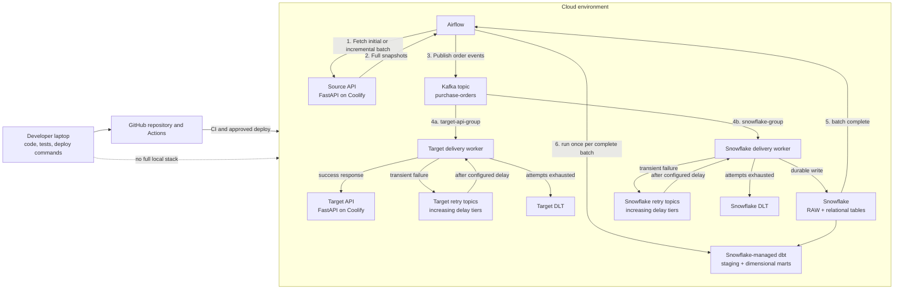
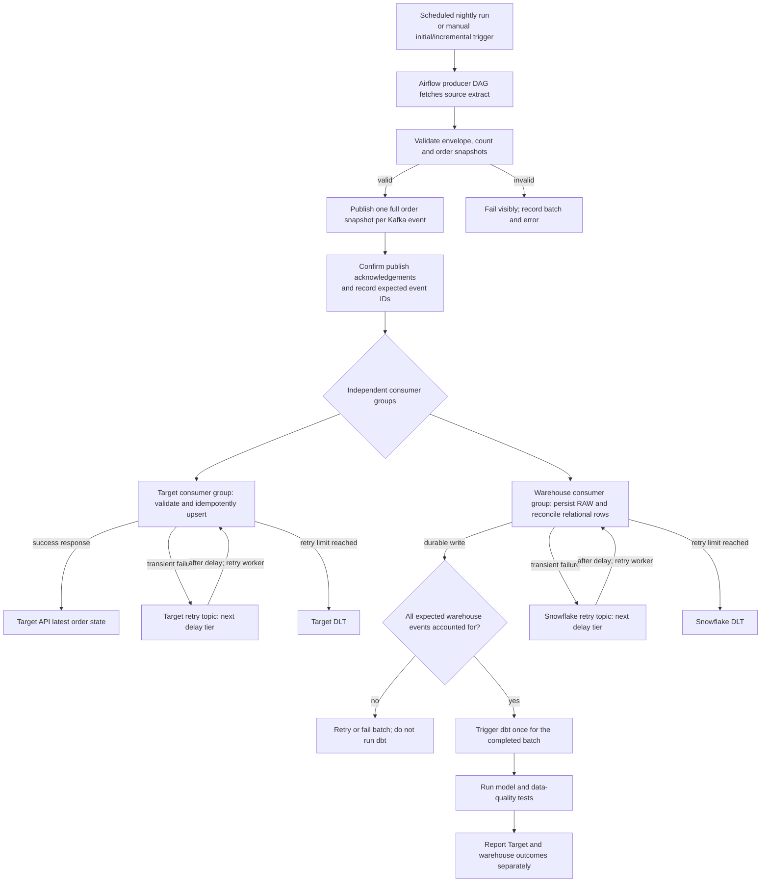

# Purchase Order Integration and Analytics Pipeline

A cloud-hosted, scheduled pipeline for moving purchase-order snapshots from a FastAPI source through Kafka to two independent destinations: a FastAPI target system and Snowflake. Airflow orchestrates each finite batch, and dbt builds reporting models over the required relational tables.

> **Project status:** Design and implementation checklist. This repository currently contains this README and `.gitignore`; the application, infrastructure and tests described below are planned work, not implemented functionality.

## Problem

The exercise is to build a reproducible integration pipeline for nested purchase-order JSON. It must deliver orders to both an operational target API and an analytics warehouse, preserve updates from an initial and an incremental extract, and provide a dimensional model for reporting. Kafka and Airflow are required parts of the design. The work should be demonstrable from a personal GitHub repository, with documented decisions and visible CI runs.

The candidate source pack is included in [`requirements_docs/`](requirements_docs/): the brief, ER diagram and fictional-data fixtures are kept together so the project does not depend on files outside this repository.

### Requirements

| ID | Requirement |
|---|---|
| R-01 | Implement a FastAPI source API that serves the supplied purchase orders. |
| R-02 | Implement a FastAPI target API that receives purchase orders. |
| R-03 | Deliver data to both the target API and Snowflake. |
| R-04 | Use Kafka publish/subscribe and Airflow orchestration, and explain their roles. |
| R-05 | Store the four relational purchase-order tables represented in the ER diagram in Snowflake. |
| R-06 | Use dbt to build a dimensional model on top of those four tables. |
| R-07 | Handle both extracts correctly; incremental records represent complete current snapshots of changed orders. |
| R-08 | Preserve parent order/line keys when flattening nested lines, coding rows and goods receipts. |
| R-09 | Use a personal GitHub repository and provide a visible GitHub Actions run. |
| R-10 | Document design decisions, including context, options, rationale and trade-offs. |
| R-11 | Use personal/local/free-tier or trial resources, and do not commit secrets. |
| R-12 | Be ready to walk through the solution in a 45–60-minute review. |

**Optional bonus items:** local Kubernetes deployment with Helm or Kustomize, and end-to-end OpenTelemetry tracing. These are deferred until the required path works.

### Required Snowflake tables

| Table | Key | Grain |
|---|---|---|
| `PURCHASE_ORDER` | `OrderNumber` | One row per order snapshot/current order. |
| `PURCHASE_ORDER_LINE` | `OrderNumber`, `LineNumber` | One row per order line. |
| `PURCHASE_ORDER_LINE_CODING_ROW` | `OrderNumber`, `LineNumber`, `RowIndex` | One row per coding/allocation row. |
| `PURCHASE_ORDER_LINE_GOODS_RECEIPT` | `GoodsReceiptNumber` | One row per goods receipt, linked to its parent order and line. |

The sample data has 100 initial order records and 20 incremental records. The incremental file contains 19 distinct order numbers, including two versions of `PO1040078`; it introduces four new orders. After selecting the newest version per order, the expected current header count is 104. Child-row counts must be calculated from the selected latest snapshots, not by adding rows from both files.

## Assumptions

The brief does not specify production traffic, an update frequency, a latency SLA, retention, or an API error contract. These are provisional assumptions for a small candidate exercise and must be revisited if requirements change.

| ID | Working assumption | Consequence |
|---|---|---|
| A-01 | Order volume is low and new data arrives infrequently; a daily overnight batch is sufficient. | Use a scheduled Airflow micro-batch, not synchronous/inline order processing or always-on consumers. Confirm the timezone and run time before scheduling. |
| A-02 | The supplied initial and incremental files are deterministic demo extracts. | Support explicit `initial` and `incremental` modes for repeatable tests; do not pretend repeated fixture requests are new daily data. |
| A-03 | Each incremental record is a full snapshot of a changed order, not a patch. | Select the latest timezone-aware `LastUpdated` version and replace that order's child rows as a complete set. |
| A-04 | Target and Snowflake delivery are independent. | Use separate Kafka consumer groups and report their batch outcomes separately; one destination can succeed while the other retries or fails. |
| A-05 | The developer laptop has limited CPU, memory and disk. | Run APIs, Kafka and Airflow in cloud environments. Use the laptop for editing, unit tests and deployment operations; avoid running the full stack locally. |
| A-06 | Source and target APIs will be deployed to the user's cloud server through Coolify. | Airflow must be able to reach their deployed HTTPS endpoints; do not configure cloud tasks to call laptop `localhost`. |
| A-07 | Snowflake is the warehouse and dbt runs in the Snowflake-managed environment. | Keep credentials in cloud secret stores/connections, not in source control. |
| A-08 | The exercise dataset is fictional and small, but correctness still matters. | Preserve financial values, cancelled statuses and negative reversing receipts; do not silently adjust business data. |

## Proposed solution

Airflow runs finite batch jobs in the cloud. The producer fetches one extract from the Source API, validates its envelope, creates stable event metadata, and publishes one full order snapshot per Kafka message. Two independent consumer flows deliver those events: one upserts the Target API, while the other writes raw events and reconciles the four relational tables in Snowflake. Once the warehouse batch is complete, Airflow invokes dbt to create tested staging and dimensional models.

### Architecture



The cloud provider/product for Airflow and Kafka remains to be selected. Whatever is chosen must provide secure connectivity from Airflow to Kafka, Snowflake and the Coolify-hosted APIs. Keep services private where possible; otherwise use HTTPS, authentication, TLS for Kafka, restricted network rules and carefully scoped credentials.

### Batch and retry flow



### Event and update handling

- Kafka topic: `purchase-orders`; message key: `OrderNumber`; value: the complete nested order snapshot.
- Event metadata: stable `event_id`, `batch_id`, `load_type`, extraction time, order number and optional Airflow run/trace identifiers.
- `event_id` must be stable on retry but distinguish separate versions of the same order. A deterministic identity can include extract identity, record position and a canonical payload hash.
- Normalize `LastUpdated` to a timezone-aware instant before comparing versions. A stale event must not overwrite a newer order. Define a deterministic tie-break for equal timestamps.
- Child rows are replaced/reconciled from the selected full snapshot. This removes children that disappeared from a later snapshot; a plain upsert alone is not sufficient.
- Keep one canonical `purchase-orders` topic and use the existing independent consumer groups for destination isolation. Add separate retry topics and DLTs for each destination: for example, `purchase-orders.target.retry.1m`, `purchase-orders.target.retry.5m`, `purchase-orders.target.retry.30m`, `purchase-orders.target.dlt`, and corresponding `purchase-orders.snowflake.retry.1m`, `purchase-orders.snowflake.retry.5m`, `purchase-orders.snowflake.retry.30m`, `purchase-orders.snowflake.dlt`. Separate primary topics are not required for this design; add them only if destinations need different access controls, retention, throughput or independent producer policies.
- Retry only transient failures, with a bounded number of attempts and increasing delay tiers. Route validation/permanent failures directly to the appropriate DLT with failure reason, attempt count and original event metadata. A DLT is an operational exception queue, not successful delivery; alert and document how to inspect and replay its records.
- Kafka does not natively wait for a per-message delay. A retry worker or scheduled Airflow task must enforce the delay tiers and publish to the next retry tier (or back to the destination worker). Do not sleep while holding a consumer partition if that would block other orders. Version-aware upserts are still needed because retries can cause later order versions to arrive first.
- Commit the source-topic offset only after the destination write is durable, or after publishing the failed event to its retry/DLT topic has itself been acknowledged. If the retry/DLT publish fails, do not commit the source offset. This is an at-least-once design: duplicate delivery is possible, so event processing must be idempotent.
- A Kafka acknowledgement does not delete a record. Committing an offset tells that consumer group it may move forward; Kafka retains the record until its retention policy expires. Target and Snowflake groups commit independently, and replay remains possible within retention.
- Track expected distinct event IDs per batch. A short/empty Kafka poll is not proof that the batch is complete.

For Target, treat a successful HTTP response as an acknowledgement only after the API has durably saved the snapshot and event identity. For Snowflake, acknowledge only after the event/audit write is committed. A DLT-published event remains unresolved for business completeness reporting until it is successfully replayed or explicitly dispositioned; do not silently count it as a successful target or warehouse write.

### Snowflake and dbt ownership

To match the brief literally, the ingestion/warehouse step owns the required four relational tables. It can flatten and reconcile the latest order snapshots in Snowflake SQL or through the ingestion code. dbt then reads those four tables to build cleaned staging models and dimensional marts.

Suggested layers:

| Layer | Contents |
|---|---|
| `RAW` | Append-only full event payloads plus event/batch ingestion status. |
| Relational source tables | The four required tables above, maintained to current state from complete snapshots. |
| dbt staging | Typed, normalized order, line, coding and receipt models. |
| dbt marts | Dimensions such as supplier, cost centre and category; facts at line, allocation and receipt grain. |

Keep measures at their natural grain. Joining coding rows and receipts directly to order lines can multiply values. Negative receipt rows are reversals and must remain visible; order value is not the same as paid or invoiced expenditure.

## Design decisions

| Decision | Choice | Why | Trade-off / revisit when |
|---|---|---|---|
| Processing style | Daily scheduled micro-batches, with manual trigger for demo extracts. | Low volume and no real-time SLA are assumed; fits Airflow and finite fixture files. | Move to continuous consumers if a low-latency SLA or volume requires it. |
| API placement | Source and target FastAPI services deployed on the user's Coolify cloud instance. | Cloud Airflow cannot reliably reach a laptop-local service; the laptop is resource-constrained. | Revisit if networking, availability or isolation requirements outgrow this host. |
| Kafka and Airflow | Cloud-hosted services; provider and deployment method TBD. | Keeps the laptop free of the heavyweight runtime and enables cloud-to-cloud connectivity. | Select a managed or self-managed option after checking cost, connectivity and free-tier limits. |
| Fan-out and recovery | One canonical topic, separate destination consumer groups, destination-specific retry tiers and DLTs. | Independent progress and failure handling without duplicating the producer stream. | Retry delay needs a worker/scheduler; at-least-once delivery requires idempotency and DLT operations. |
| Kafka payload | One complete order per event, keyed by order number. | Preserves order boundaries and supports partition affinity and replay. | Batch-level metadata must be tracked separately. |
| Batch orchestration | Three logical Airflow DAGs: extract/publish, Target delivery, warehouse ingestion/dbt. | Keeps source and destination responsibilities distinct. | Requires explicit cross-DAG batch completion and prevents unsafe overlapping runs. |
| Incremental semantics | Latest complete snapshot replaces current header and child state. | Matches the stated meaning of incremental records and handles child removals. | Requires timestamp normalization, deterministic ties and atomic reconciliation. |
| Target API | Idempotent version-aware upsert, proposed `PUT /purchase-orders/{order_number}`. | Retry after timeout must not duplicate effects; newer order versions remain valid updates. | HTTP method/schema are assumptions until the contract is implemented. |
| Warehouse model | Ingestion maintains the four relational tables; dbt builds analytics on top. | Follows the requirement that dbt's dimensional model sits on the four tables. | Transformation logic is split between ingestion SQL/code and dbt. |
| Optional work | Kubernetes and OpenTelemetry after required acceptance tests pass. | Protects the timebox and cloud budget. | Bonus work may be omitted if it puts correctness or delivery at risk. |

## Implementation checklist

Check items as they are completed. The checklist is a plan; unchecked items are not implemented yet.

### 1. Provision cloud services

- [ ] Create a personal Snowflake account/database, warehouse, schemas and least-privilege role.
- [ ] Create a cloud Kafka cluster and `purchase-orders` topic; configure TLS, credentials, partitions, retention and consumer access.
- [ ] Create destination-specific retry topics with increasing delay tiers and separate Target/Snowflake DLTs; set retention and access policies.
- [ ] Create a cloud Airflow environment and securely configure connections to Kafka, Snowflake and the Coolify API endpoints.
- [ ] Confirm cloud egress, DNS, firewall rules, HTTPS certificates, provider limits and expected charges.
- [ ] Decide how credentials will be stored and rotated; keep them out of Git and logs.

### 2. Build and deploy the APIs

- [ ] Copy the supplied fictional fixtures into the repository's `data/` directory.
- [ ] Implement the deterministic Source API with explicit `initial` and `incremental` modes and response-count validation.
- [ ] Implement the Target API with persistent state, processed-event idempotency and stale-version protection.
- [ ] Add API health checks, input validation, authentication and useful structured logs.
- [ ] Build and deploy both APIs to the Coolify instance; confirm Airflow can reach their HTTPS endpoints.

### 3. Implement Airflow and Kafka processing

- [ ] Define and test the event envelope, stable event identity and serialization contract.
- [ ] Implement the producer DAG: fetch, validate, assign batch/event metadata, publish and verify acknowledgements.
- [ ] Implement the Target consumer with bounded polling, transient-error classification, retry tiers, DLT handling, idempotent upsert and safe offset commits.
- [ ] Implement the Snowflake consumer with bounded polling, transient-error classification, retry tiers, DLT handling, durable raw ingestion, event audit and safe offset commits.
- [ ] Implement or schedule retry workers that enforce delay tiers without blocking unrelated partition work; document DLT inspection and replay.
- [ ] Track the expected event IDs and verify warehouse batch completeness before starting dbt.
- [ ] Trigger each destination once per extract, not once per order; prevent overlapping initial/incremental runs until isolation is proven.
- [ ] Make partial destination success visible and provide a documented retry/replay path.

### 4. Implement Snowflake tables and dbt models

- [ ] Create DDL for RAW/event audit and all four ERD relational tables.
- [ ] Flatten nested lines, coding rows and receipts while carrying parent keys into every child row.
- [ ] Reconcile complete snapshots atomically, removing/replacing child rows absent from the latest snapshot.
- [ ] Create dbt staging models and dimensional facts/dimensions at their correct grains.
- [ ] Add key, not-null, relationship and business reconciliation tests; run dbt only after a complete batch.

### 5. Verify, document and present

- [ ] Test initial load, incremental load, duplicate replay, out-of-order versions and repeated `PO1040078` records.
- [ ] Test child-row removal, cancelled orders/lines, null `ProjectCode`, string quantities and negative receipt reversals.
- [ ] Simulate Target API and Snowflake failures; confirm independent recovery and safe offset behavior.
- [ ] Confirm final current header count is 104 and calculate child counts from latest snapshots.
- [ ] Add GitHub Actions for tests, lint/type checks and container builds; keep deployment gated/approved.
- [ ] Record actual run counts, limitations, provider choices and screenshots/log evidence for the walkthrough.
- [ ] Consider Kubernetes and OpenTelemetry only after the required path is green.

## Planned repository structure

Only add directories when they contain working code or useful documentation.

```text
purchase-order-pipeline/
├── README.md
├── requirements_docs/
│   ├── CANDIDATE_INSTRUCTIONS.pdf
│   ├── ER_DIAGRAM.pdf
│   └── sample_data/
│       ├── purchased_order_initial.json
│       └── purchased_order_incremental.json
├── api/
│   ├── source/
│   └── target/
├── integration/
│   ├── event_contract.py
│   ├── kafka_producer.py
│   ├── target_delivery.py
│   └── snowflake_ingestion.py
├── dags/
│   ├── extract_publish.py
│   ├── consume_target.py
│   └── consume_snowflake.py
├── snowflake/
│   ├── create_schemas.sql
│   └── create_relational_tables.sql
├── dbt/
│   ├── dbt_project.yml
│   └── models/
│       ├── staging/
│       └── marts/
├── tests/
├── infrastructure/
├── docs/
│   ├── adr/
│   └── walkthrough.md
├── .github/workflows/
├── .env.example
└── .gitignore
```

## Build, commit and deploy

Implementation commands will be finalized when the corresponding code and dependency manifests exist. Do not treat the examples below as runnable in the current repository state.

### Local development

The intended local workflow is to run lightweight unit/contract tests on the laptop, while connecting to cloud Kafka, Airflow and Snowflake only with development credentials. Do not start a full local Kafka/Airflow stack by default.

Planned validation commands (update to match the chosen Python tooling):

```bash
python -m venv .venv
source .venv/bin/activate
python -m pip install -r requirements-dev.txt
pytest
```

Add `.env.example` with variable names and placeholder values only. Keep real credentials in local ignored `.env` files or cloud secret stores. Never commit Snowflake keys/passwords, Kafka certificates, API tokens, provider state files or real customer data.

### Git and commits

Use small commits that describe one change, for example `feat: add source API fixture endpoint` or `test: cover stale order snapshots`. Review `git status` before staging so secrets and generated files are not included.

```bash
git switch -c feat/source-api
git status
git add README.md api/source tests
git commit -m "feat: add source API fixture endpoint"
git push -u origin feat/source-api
```

The staging paths above are examples and become valid after those files exist. Use pull requests or reviewed commits so the repository history shows the implementation progression requested by the exercise.

### CI and cloud deployment

1. GitHub Actions should run tests, formatting/lint checks and container builds on pull requests and pushes.
2. Deploy API images from the personal GitHub repository to the Coolify instance using a protected deployment credential. Keep the Source and Target API configuration separate.
3. Deploy DAG code to the selected Airflow service using its supported Git/DAG synchronization method. Configure provider connections and secrets in Airflow's secret backend or connection manager.
4. Provision/configure Kafka and Snowflake separately from application code. Use infrastructure-as-code only if it can be safely validated and state is secured; do not enable unattended destructive applies.
5. Configure the Snowflake-managed dbt project to pull from the repository and run after the warehouse DAG reports a complete batch. Check dbt tests and run history.
6. Smoke-test both deployed API health endpoints, Kafka publish/consume, Snowflake row counts and dbt completion. A successful image build or infrastructure plan alone is not end-to-end evidence.

Exact Docker, Coolify, Airflow, Kafka and dbt commands will be added after provider choices and implementation files are in place.

## Future work

- Continuous Kafka consumers if a real-time latency target is introduced.
- Automated DLT alerting, an operator dashboard and a controlled replay utility.
- Schema Registry and explicit event schema evolution.
- OpenTelemetry trace propagation and a managed or lightweight trace viewer.
- Kubernetes deployment with Helm or Kustomize, if useful and affordable.
- Stronger batch dashboarding, alerts, retention and operational runbooks.
- CI end-to-end tests against isolated cloud resources and separate staging/production environments.
- Production-grade availability, network isolation, credential rotation and cost controls.
- Confirm business definitions for late receipts, cancellations and financial reporting before expanding the marts.

## Acceptance criteria

- [ ] Initial extract publishes 100 order events and reaches both destinations.
- [ ] Incremental extract publishes 20 records, including both versions of `PO1040078`.
- [ ] Reconciliation produces 104 current orders, with children from each order's newest complete snapshot.
- [ ] Replaying an event has no duplicate effect, and a stale event cannot overwrite a newer version.
- [ ] Receipt reversals, coding splits, cancelled rows and parent keys are preserved correctly.
- [ ] Warehouse offsets are not acknowledged before durable persistence; incomplete batches do not trigger dbt.
- [ ] A failure in one destination does not hide the status or block diagnosis of the other destination.
- [ ] GitHub Actions is green, no secrets are committed, and the setup/run/deploy process can be followed by a reviewer.