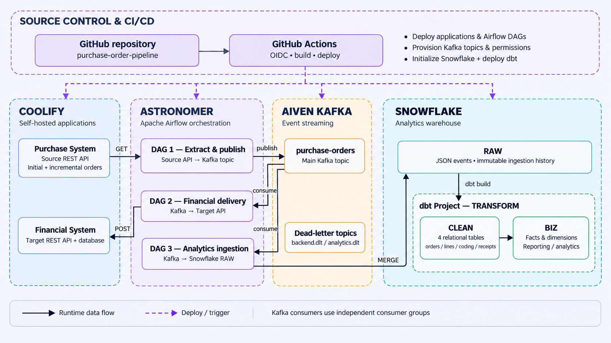

# Purchase Order Integration and Analytics Pipeline

A FastAPI Source API serves sample purchase orders. Airflow on Astronomer (Astro) validates each extract and publishes one snapshot per order to Aiven Kafka. Two independent Airflow consumers deliver the same events to a MySQL-backed Target API and to Snowflake. Snowflake-managed dbt builds the CLEAN and BIZ reporting models from RAW events.



The cloud steps below use the `test` environment. DAG 1 triggers the Target and Snowflake consumers independently after Kafka acknowledges the batch.

## Run the cloud pipeline

### 1. Prepare the services

| Service | What to configure |
|---|---|
| **Coolify** | Create a **Docker Compose Empty** service and paste [compose.coolify.yaml](compose.coolify.yaml). Map your HTTPS hostnames to `source-api` on port `8000` and `target-api` on port `8001`. Set `SOURCE_API_USERNAME`, `SOURCE_API_PASSWORD`, `TARGET_API_USERNAME`, `TARGET_API_PASSWORD`, and the Target API's `MYSQL_HOST`, `MYSQL_DATABASE`, `MYSQL_USER`, and `MYSQL_PASSWORD`. Set `MYSQL_PORT` if it differs from `3306`. Give Coolify pull access if the GHCR images are private. |
| **MySQL** | Create the database. Use an initializer account with `CREATE` permission and a runtime account with `SELECT`, `INSERT`, and `UPDATE` on the Target API tables. The GitHub runner needs network access to MySQL for initialization, and Coolify needs access at runtime. |
| **Aiven** | Create a project and Kafka service with SASL enabled. Create an API token that can manage Kafka topics, service users, and Kafka-native ACLs. The initializer provisions them using [application.properties](integration/po_pipeline/application.properties). |
| **Astro** | Create a deployment and a token with access to deploy its image and DAGs. Follow the [Astro runbook](airflow/README.md#set-up-the-deployment) for deployment settings. |
| **Snowflake** | Create `PURCHASE_ORDER_DB`, the `RAW`, `CLEAN`, and `BIZ` schemas, `PO_WAREHOUSE`, and `PURCHASE_ORDER_PIPELINE_ROLE`. Apply the [pipeline access grants](snowflake/init/grant-pipeline-access.sql) and configure [GitHub Actions OIDC](docs/snowflake-github-actions-oidc.md). An admin can create and grant access to `TRANSFORM` with the [TRANSFORM setup SQL](snowflake/init/initialize-transform.sql). |

If you deploy from a fork, update the GHCR image paths in the deploy workflow and the Coolify Compose definition, and use your repository's OIDC subject in Snowflake.

### 2. Configure GitHub Actions

In the repository, go to **Settings → Environments → `test`** and add these settings.

| Used for | Environment variables | Environment secrets |
|---|---|---|
| Coolify | `COOLIFY_API_URL`, `COOLIFY_SERVICE_UUID`, `SOURCE_API_URL`, `TARGET_API_URL` | `COOLIFY_AUTH_TOKEN` |
| Astro | `ASTRO2_DEPLOYMENT_ID` | `ASTRO2_API_TOKEN` |
| Snowflake | `SNOWFLAKE_ACCOUNT` | — |
| MySQL initialization | `MYSQL_HOST`, `MYSQL_DATABASE`, `MYSQL_INIT_USER` | `MYSQL_INIT_PASSWORD` |
| Aiven provisioning | `AIVEN_PROJECT`, `AIVEN_SERVICE_NAME` | `AIVEN_API_TOKEN` |

Use the Coolify API base ending in `/api/v1` and the API base URLs without `/health`. Use the Snowflake organization-account identifier for `SNOWFLAKE_ACCOUNT`. Add `MYSQL_PORT` for a nonstandard initializer port.

For verification, set `AIRFLOW_BASE_URL` without `/api/v2` if Astro URL discovery fails. Add the `KAFKA_CONSUMER_SASL_PASSWORD` secret to enable the Kafka topic check. If using a broker different from the one in [airflow/env.vars](airflow/env.vars), set the GitHub variable `KAFKA_BOOTSTRAP_SERVERS` for that check.

### 3. Initialize and deploy

1. In GitHub **Actions**, run [Initialize environment](.github/workflows/initialize-environment.yml) with environment `test` and component `all`. It creates the MySQL tables, provisions Kafka, and creates the Snowflake RAW, CLEAN, and BIZ objects. If you skipped the admin setup for `TRANSFORM`, enable `bootstrap_transform` only when the workflow role can create the schema and grant access.
2. Retrieve the Kafka service user credentials from Aiven. In Astro, configure the API base URLs, API Basic Auth secrets, Kafka broker and SASL credentials, and the Airflow Snowflake connection. Start from [airflow/env.vars.example](airflow/env.vars.example) and set `SNOWFLAKE_DBT_PROJECT` to `PURCHASE_ORDER_DB.TRANSFORM.PO_DBT_PROJECT`. Use a CA certificate that matches your Kafka service and keep credentials in the platform's secret settings. See the [Astro settings table](airflow/README.md#set-up-the-deployment).
3. From `main`, run [Deploy APIs, DAGs, and dbt](.github/workflows/deploy-apis-dags-dbt.yml) separately with `api`, `dbt`, and `dags`. The API run publishes both images to GHCR and sets `IMAGE_TAG` in Coolify. The dbt run publishes the managed project to Snowflake. The DAG run deploys the Astro image and DAGs.
4. Run the deployment workflow with `verify` and review its output, including any health warnings. If Coolify has an older saved Compose definition, apply the current [compose.coolify.yaml](compose.coolify.yaml) in Coolify and redeploy.

### 4. Run a batch in Airflow

1. Unpause the pipeline DAGs and run `dag_test_connections` to check the API, Kafka, and Snowflake connections.
2. Trigger `dag_source_api_to_kafka` with `{"load_type":"initial"}`. The bundled initial extract contains **100 orders**.
3. Check that `dag_kafka_to_target_api` delivered the orders to the Target API and that `dag_kafka_to_snowflake` loaded RAW events and completed `dbt build`. Review the [delivery and recovery guide](airflow/README.md#delivery-and-recovery) if a record is quarantined.
4. Repeat with `{"load_type":"incremental"}` after the consumers finish. The incremental fixture contains **20 orders**.

For reporting, use the secure views in `PURCHASE_ORDER_DB.BIZ`. An administrator can apply the [BI reader grants](snowflake/init/grant-bi-view-access.sql) after the views exist.

## Run or test locally

To try the APIs locally, create an ignored root `.env` with `SOURCE_API_USERNAME` and `SOURCE_API_PASSWORD`. To also start the Target API and local MySQL, add `TARGET_API_USERNAME`, `TARGET_API_PASSWORD`, `MYSQL_PASSWORD`, and `MYSQL_ROOT_PASSWORD`.

```bash
docker compose up --build -d source-api
curl -fsS http://127.0.0.1:8000/health

docker compose --profile target up --build -d target-api
curl -fsS http://127.0.0.1:8001/health
```

Both `/health` endpoints are public. The purchase-order routes and Swagger `/docs` require Basic Auth. See the [Source API guide](api/source/README.md) and [Target API guide](api/target/README.md) for standalone setup.

Run the unit tests with Python 3.12.

```bash
python3.12 -m venv .venv
source .venv/bin/activate
python -m pip install -r api/source/requirements.txt -r api/target/requirements.txt \
  -r integration/requirements.txt 'httpx>=0.28,<1'
python -m unittest discover -s tests -v
```

The [assignment brief and ER diagram](requirements_docs/) describe the source data and the original requirements.
